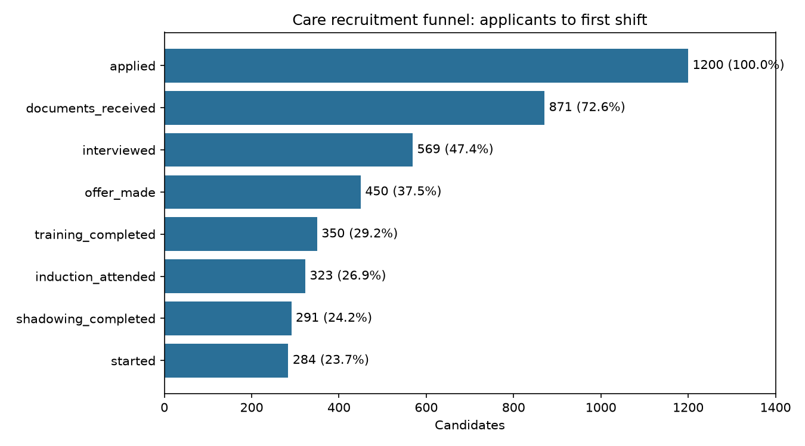
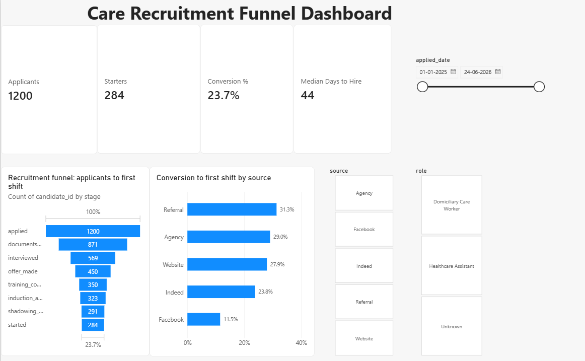

# Care Recruitment Funnel & Time-to-Hire Analysis

Analysis of where a UK domiciliary care provider loses candidates across an 8-stage recruitment process, which recruitment sources produce the most starters, and how long hiring takes.

## Business questions

1. What share of applicants actually start work?
2. Which stage of the process loses the most candidates?
3. Which recruitment sources produce the best candidates?
4. How long does hiring take, and which stage is slowest?

## Data

**Synthetic dataset** of 1,200 candidates (January 2025 – June 2026), generated in Python to model a real care-sector recruitment workflow: application → documents → interview → offer → Care Certificate training → induction → shadowing → first shift.

Realistic data quality issues were added deliberately (duplicate rows, inconsistent text, missing values) to practise cleaning. No real personal data is used.

## Approach

| Step | Notebook | What it does |
| --- | --- | --- |
| 1 | `01_create_data.ipynb` | Generates the synthetic candidate dataset |
| 2 | `02_clean_data.ipynb` | Removes 15 duplicates, standardises source names, handles 10 missing roles, converts dates, validates date order |
| 3 | `03_funnel_analysis.ipynb` | Calculates stage and step conversion rates, compares sources, measures time-to-hire and stage durations |
| 4 | `04_sql_analysis.ipynb` | Recalculates headline figures in SQL (SQLite) and cross-checks them against pandas |
| 5 | `recruitment_dashboard.pbix` | Interactive Power BI dashboard |

## Power BI dashboard

Interactive dashboard (`recruitment_dashboard.pbix`) with KPI cards, stage funnel, conversion by source, and slicers for source, role and application date. Built with Power Query (unpivoting stages into a long table), a one-to-many data model, and DAX measures.

## Key findings

- **23.7% of applicants start work** (284 of 1,200), roughly 1 in 4.
- **Interview scheduling is the weakest step**: only 65.3% of candidates who sent documents were interviewed.
- **Referrals convert almost 3x better than Facebook** (31.3% vs 11.5%). Indeed brings the most applicants but converts at 23.8%.
- **Median time-to-hire is 44 days** (mean 47.6). Shadowing is the slowest stage (median 15 days), then training (11 days).

## Recommendations

- Contact candidates within 24–48 hours of receiving documents to reduce drop-off before interview.
- Introduce a staff referral scheme and review Facebook advertising spend.
- Use a structured shadowing plan to shorten time-to-hire.

## Limitations

- Synthetic data: the patterns demonstrate the method, not a real organisation's performance.
- Candidates who dropped out mid-stage have no recorded date, so the time spent before dropping out can't be measured.
- No data on candidate feedback, so the *reasons* for drop-off are not covered.

## Tools

Python (pandas, NumPy, matplotlib) · SQL (SQLite) · Power BI (Power Query, DAX) · Jupyter Notebook · Git/GitHub

## How to run

1. Install [Anaconda](https://www.anaconda.com/download)
2. Clone this repository
3. Run the notebooks in order: 01 → 02 → 03